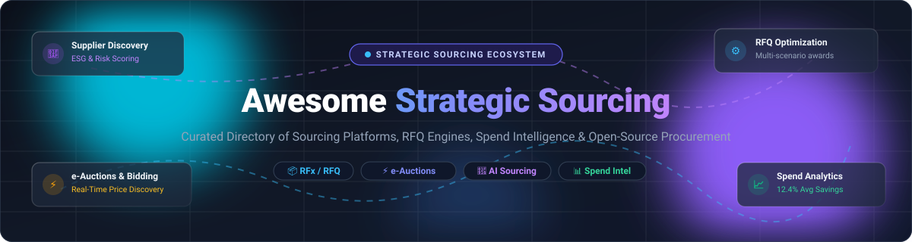

<p align="center">
  
</p>

<p align="center">
  <a href="https://github.com/ishandutta2007/Awesome-Awesome-Awesome"></a>
  <a href="https://discord.gg/jc4xtF58Ve"></a>
  <a href="https://github.com/ishandutta2007/Awesome-Strategic-Sourcing/stargazers"></a>
  <a href="https://github.com/ishandutta2007/Awesome-Strategic-Sourcing/network/members"></a>
  <a href="https://github.com/ishandutta2007/Awesome-Strategic-Sourcing/blob/main/LICENSE"></a>
  <a href="https://github.com/ishandutta2007/Awesome-Strategic-Sourcing/pulls"></a>
  <a href="https://github.com/ishandutta2007"></a>
</p>

---

# 📦 Awesome Strategic Sourcing

> A definitive, SEO-optimized directory of **Strategic Sourcing Platforms**, **RFQ/RFP Automation Engines**, **e-Sourcing Solutions**, **Spend Intelligence Platforms**, and **Open-Source Procurement Repositories**.

**Keywords:** `Strategic Sourcing`, `e-Sourcing`, `RFQ Automation`, `Reverse Auctions`, `Spend Analytics`, `Supplier Management`, `Source-to-Pay (S2P)`, `Procurement Automation`, `Bid Comparison`, `Contract Award Optimization`.

Strategic Sourcing transforms procurement from tactical purchasing into a competitive, data-driven discipline. Modern sourcing software automates category strategy, vendor pre-qualification, competitive bidding (RFIs, RFQs, RFPs, and reverse auctions), multi-variable scenario modeling (balancing cost, risk, lead times, capacity, ESG metrics), and contractual awards.

---

## 📑 Table of Contents

- [🌐 Sector Overview & Market Dynamics](#-sector-overview--market-dynamics)
- [🏢 SaaS & Hosted Strategic Sourcing Platforms](#-saas--hosted-strategic-sourcing-platforms)
- [💻 Open-Source GitHub Projects](#-open-source-github-projects)
- [🔄 Strategic Sourcing Lifecycle & Architecture](#-strategic-sourcing-lifecycle--architecture)
- [🤝 How to Contribute](#-how-to-contribute)
- [📈 Star History](#-star-history)
- [💖 Support & Sponsoring](#-support--sponsoring)
- [⚖️ Disclaimer & License](#️-disclaimer--license)

---

## 🌐 Sector Overview & Market Dynamics

* **Estimated Market Size:** The global strategic sourcing and e-sourcing software market is estimated at **$10.49 billion in 2025** and is projected to expand to **$13.14 billion in 2026**, on track to exceed **$17.0 billion to $22.0 billion by 2030–2035** at a compound annual growth rate (CAGR) of approximately **10.15%**.
* **Market Dynamics & Fragmentation:** The sector is **moderately fragmented** with a distinctive "barbell" structure rather than a winner-take-all monopoly. Comprehensive legacy ERP suites (SAP Ariba, Workday, Coupa) anchor core enterprise spend and general ledger integrations, while specialized best-of-breed AI platforms (Keelvar for mathematical multi-variable scenario optimization, Zip for intake-to-procure orchestration, and Fairmarkit for autonomous tail-spend sourcing) capture high-growth niches. High customization barriers across indirect goods, direct materials, freight logistics, and stringent regional procurement regulations prevent single-vendor monopolization.

---

## 🏢 SaaS & Hosted Strategic Sourcing Platforms

The table below compiles leading strategic sourcing and spend management SaaS platforms, sorted in descending order by **Company Size (Revenue / Valuation)**.

| 🏢 Platform / Product | 📈 Company Size (Valuation / Revenue) | 💰 Pricing (Starting Tier) | 🎁 Free Tier Limits / Free Trial | 🔍 Core Sourcing Capabilities & Best For |
| :--- | :--- | :--- | :--- | :--- |
| **[SAP Ariba](https://www.sap.com/products/spend-management/sourcing.html)** | **~$260 Billion Market Cap** (Annual Revenue: ~$36.0B) | **$2,420 / month** (~$29,040/year) for SAP Strategic Procurement cloud starter module | **30-day interactive sandbox trial** (guided simulation with sample RFQs and preloaded supplier datasets; external supplier bidding restricted) | Global enterprise Source-to-Contract with RFx, reverse auctions, supplier network discovery, and ERP integration. |
| **[Workday Strategic Sourcing](https://www.workday.com/en-us/products/spend-management/strategic-sourcing.html)** | **~$65 Billion Market Cap** (Annual Revenue: ~$7.3B) | **$1,000 / month** ($12,000/year billed annually) for core team RFx & sourcing event manager | **14-day guided proof-of-concept trial** with up to 2 test sourcing events and 5 simulated supplier bids | Collaborative RFx authoring, bid line-item comparisons, and unified spend visibility across enterprise Workday workflows. |
| **[Coupa Sourcing](https://www.coupa.com/products/sourcing)** | **$8.0 Billion Valuation** (Annual Revenue: ~$800M+) | **$1,250 / month** ($15,000/year billed annually) for mid-market standalone Sourcing package | **Free Forever Supplier Portal** (free for suppliers to submit unlimited RFQ bids and e-invoices); **14-day vendor-guided sandbox pilot** for enterprise buyers | Business Spend Management (BSM) module with automated RFx workflows, supplier bid portals, and category spend strategy. |
| **[Zip (ZipHQ)](https://zip.com/)** | **$2.2 Billion Valuation** (Series D, $190M raised) | **$3,333 / month** ($40,000/year billed annually) for SMB/Mid-market Intake-to-Procure package (up to 500 users) | **14-day pilot sandbox** with preconfigured intake workflow templates and ERP connectors upon sales demo qualification | Modern intake orchestration, AI vendor evaluation, automated approvals, and cross-department procurement routing. |
| **[Ivalua](https://www.ivalua.com/)** | **$1.5 Billion Valuation** (Annual Revenue: ~$180M+) | **$12,500 / month** ($150,000/year billed annually) for modular Source-to-Contract foundation | **30-day structured proof-of-concept (PoC)** sandbox environment limited to 1 category taxonomy and 10 vendor profiles | Deep direct and indirect materials sourcing, supplier lifecycle tracking, risk management, and conversational analytics. |
| **[Jaggaer (Jaggaer One)](https://www.jaggaer.com/)** | **$1.5 Billion Valuation** (Annual Revenue: ~$250M+) | **$11,667 / month** ($140,000/year billed annually) for Jaggaer One Strategic Sourcing standalone suite | **14-day custom scoped proof-of-concept environment** limited to 1 mock e-Auction and 3 sample RFx events | Advanced RFx template import, conditional assessment rules, automated supplier gating, and direct manufacturing procurement. |
| **[GEP SMART](https://www.gep.com/software/gep-smart/sourcing)** | **~$1.5 Billion Valuation** (Annual Revenue: ~$450M+) | **$1,667 / month** ($20,000/year billed annually) for GEP SMART Sourcing module | **14-day guided evaluation sandbox** with pre-built category RFx templates and simulated supplier scorecarding | AI-driven source-to-pay software with auto-scoring e-auctions, contract lifecycle tracking, and supplier risk dashboards. |
| **[Fairmarkit](https://www.fairmarkit.com/)** | **~$300 Million Valuation** (Series C, $78M raised) | **$1,500 / month** ($18,000/year billed annually) for autonomous tail-spend sourcing automation engine | **30-day proof-of-value trial** limited to analyzing 1 ERP spend data extract and running up to 5 pilot quote requests | Autonomous sourcing engine tailored to tail spend and below-threshold purchasing with AI vendor recommendations. |
| **[Keelvar](https://www.keelvar.com/)** | **~$200 Million Valuation** (Series B, $43M raised) | **$2,000 / month** ($24,000/year billed annually) for Sourcing Optimizer single-category starter package | **14-day scenario optimization pilot** with 1 test sourcing event and up to 50 bid line items | High-dimensional scenario modeling, multi-variable mathematical optimization bots, and freight/logistics bid analysis. |
| **[Sievo](https://sievo.com/)** | **~$120 Million Valuation** (Annual Revenue: ~$40M+) | **$1,667 / month** ($20,000/year billed annually) for spend analytics & sourcing opportunity identification baseline | **30-day spend analytics trial** with 1 historical spend dataset upload (up to $50M in spend lines analyzed) | Spend classification, procurement analytics, ESG compliance tracking, and automated sourcing savings realization. |
| **[Market Dojo](https://marketdojo.com/)** | **~$35 Million Valuation** (Acquired by Esker) | **£1,000 / month** (~$1,300/mo) or **£6,000 / year** (~$7,800/yr), or **£1,000/event** on-demand pay-as-you-go | **Free Forever Unlimited Sandpit** (unlimited test RFQs/auctions with simulated suppliers); **14-day live trial** for 1 active tender event | Transparent, on-demand e-sourcing, dynamic reverse auctions, supplier onboarding, and questionnaire management. |
| **[Tradogram](https://www.tradogram.com/)** | **~$15 Million Valuation** (Bootstrapped / Private) | **$99 / month** (billed annually at $1,188/year) for 1+ users, or $18/user/month for team plans | **Free Forever Plan** (1 user, up to 5 transactions/purchase orders per month, 10 suppliers, unlimited basic RFQs) | Accessible, lightweight procurement and sourcing management software for small-to-medium businesses. |
| **[ProcurePort](https://www.procureport.com/)** | **~$10 Million Valuation** (Private) | **$199 / month** ($2,388/year billed annually) for e-Sourcing starter tier | **14-day full-feature trial** with up to 1 live reverse auction or RFQ event and 10 supplier invites | Cloud-hosted e-Sourcing, competitive reverse auctions, sealed bid tenders, and purchase order workflow automation. |

---

## 💻 Open-Source GitHub Projects

The following open-source repositories provide tools, frameworks, and engines for RFQ automation, reverse auctions, spend analysis, and public/private tender matching. Sorted in descending order by **GitHub Star Count**.

### 1. **[BidMaster-Pro](https://github.com/guangshu100/BidMaster-Pro)** [](https://github.com/guangshu100/BidMaster-Pro/stargazers)
* **Focus:** Full-process intelligent tender & bidding AI agent.
* **Tech Stack:** Python, RAG Knowledge Base, OCR extraction, Multi-LLM switching.
* **Capabilities:** Automates tender document generation, RFP interpretation, 21-point automated compliance checking, commercial opportunity discovery, and document formatting directly into deliverable DOCX formats.

### 2. **[Open Contracting Data Standard (OCDS)](https://github.com/open-contracting/standard)** [](https://github.com/open-contracting/standard/stargazers)
* **Focus:** Global standard schemas for public and enterprise procurement transparency.
* **Tech Stack:** JSON Schema, Python.
* **Capabilities:** Standardized data model used internationally to publish structured procurement data across all stages: planning, tender (RFQ/RFP), bid evaluation, contract awards, and ongoing implementation.

### 3. **[ForgeFlow](https://github.com/JayleeBot/ForgeFlow)** [](https://github.com/JayleeBot/ForgeFlow/stargazers)
* **Focus:** AI email agent for procurement quote management.
* **Tech Stack:** Python, AI Agents, IMAP/SMTP parser.
* **Capabilities:** Listens to incoming vendor quotation emails, parses unstructured price quotes, extracts line-item pricing and delivery dates, and structures data into procurement comparison matrices.

### 4. **[1688-cli](https://github.com/superjack2050/1688-cli)** [](https://github.com/superjack2050/1688-cli/stargazers)
* **Focus:** AI-agent-friendly command-line tool for wholesale product sourcing.
* **Tech Stack:** Node.js, CLI, REST API.
* **Capabilities:** Automates product research, supplier evaluation, RFQ inquiries, price benchmarking, and order tracking from global wholesale supply chains.

### 5. **[OpenProcurement API](https://github.com/openprocurement/openprocurement.api)** [](https://github.com/openprocurement/openprocurement.api/stargazers)
* **Focus:** Core electronic procurement engine powering national-scale procurement (Prozorro).
* **Tech Stack:** Python, Pyramid, CouchDB.
* **Capabilities:** Full-lifecycle procurement datastore and RESTful API managing tender announcements, electronic bid submissions, qualification checks, bid evaluation, award decisions, and contract tracking.

### 6. **[Open-Tender-Watch](https://github.com/bit-of-a-shambles/open-tender-watch)** [](https://github.com/bit-of-a-shambles/open-tender-watch/stargazers)
* **Focus:** Procurement monitoring and corruption risk intelligence.
* **Tech Stack:** Ruby on Rails 8, PostgreSQL.
* **Capabilities:** Monitors public and private procurement tenders across EU databases to identify corruption risk patterns, collusive bidding indicators, single-bidder red flags, and anomalous pricing.

### 7. **[eForms-SDK](https://github.com/OP-TED/eForms-SDK)** [](https://github.com/OP-TED/eForms-SDK/stargazers)
* **Focus:** European Union digital notification standard for public procurement procedures.
* **Tech Stack:** XML Schema, Schematron, JSON.
* **Capabilities:** Provides schemas, business rules, and SDK toolkits to construct, validate, and publish standard public tender notices and contract award criteria across the European economic area.

### 8. **[Reverse-Auction-Guide](https://github.com/mountainview8868/reverse-auction-guide)** [](https://github.com/mountainview8868/reverse-auction-guide/stargazers)
* **Focus:** Architectural blueprint for real-time reverse auction engines.
* **Tech Stack:** Architecture Specifications, Markdown, Dynamic Form Samples.
* **Capabilities:** Reference architectures and integration guides for deploying real-time reverse auction mechanisms, bidder confidentiality rules, dynamic time extensions, and automated price discovery.

### 9. **[OpenProcurement Auction](https://github.com/openprocurement/openprocurement.auction)** [](https://github.com/openprocurement/openprocurement.auction/stargazers)
* **Focus:** Real-time multi-round electronic reverse auction module.
* **Tech Stack:** Python, Eventlet, WebSockets, CouchDB.
* **Capabilities:** Real-time auction module supporting English and Dutch reverse auction formats with dynamic countdown timers, anonymous bidder IDs, and automated winner calculation.

### 10. **[otc-rfq](https://github.com/joaquinbejar/otc-rfq)** [](https://github.com/joaquinbejar/otc-rfq/stargazers)
* **Focus:** High-performance Request-for-Quote (RFQ) and quote aggregation engine.
* **Tech Stack:** Rust, SBE, FIX 4.4, WebSockets, gRPC.
* **Capabilities:** High-throughput reverse-auction quote aggregation engine featuring sub-millisecond execution, venue connectivity, and deterministic best-price award calculations.

### 11. **[mcp-procurement](https://github.com/zavora-ai/mcp-procurement)** [](https://github.com/zavora-ai/mcp-procurement/stargazers)
* **Focus:** Source-to-pay Model Context Protocol (MCP) server for autonomous AI agents.
* **Tech Stack:** Rust, MCP Protocol.
* **Capabilities:** Exposes **37 MCP tools** covering RFQ creation (`rfq_create`), side-by-side bid comparison (`rfq_compare`), historical price benchmarking (`price_benchmark`), multi-factor supplier risk scoring (`supplier_risk_score`), and automated negotiation briefing (`negotiation_brief`).

### 12. **[VendSync (BidFlow)](https://github.com/RavalMunjal/VendSync)** [](https://github.com/RavalMunjal/VendSync/stargazers)
* **Focus:** Full-stack procurement and vendor management ERP.
* **Tech Stack:** React, Node.js, Express, MongoDB.
* **Capabilities:** Vendor portal for independent quote submissions, side-by-side quotation matrices with auto-highlighted lowest bids, approval hierarchies, and automatic conversion from accepted bids to purchase orders.

### 13. **[opentradeintel](https://github.com/b2baitrade-ui/opentradeintel)** [](https://github.com/b2baitrade-ui/opentradeintel/stargazers)
* **Focus:** B2B sourcing intelligence and tender discovery engine.
* **Tech Stack:** Python, FastAPI, Typer CLI.
* **Capabilities:** Harvests European procurement notices from TED Search APIs, transforms notices into normalized tender schemas, and matches them against vendor catalogs using deterministic similarity scoring.

### 14. **[aribaiq](https://github.com/jvasanthada/aribaiq)** [](https://github.com/jvasanthada/aribaiq/stargazers)
* **Focus:** Python analytics library for procurement and supplier intelligence.
* **Tech Stack:** Python, Pandas, NumPy.
* **Capabilities:** Generates supplier intelligence scorecards (on-time rate, defect rate, ESG performance), category spend concentration analysis, and LLM prompt generation for procurement copilot workflows.

### 15. **[BidForge](https://github.com/tan1ro/BidForge)** [](https://github.com/tan1ro/BidForge/stargazers)
* **Focus:** Full-stack RFQ bidding platform with British Auction mechanics.
* **Tech Stack:** FastAPI, MongoDB, React, Material UI, WebSockets.
* **Capabilities:** Dynamic time extensions, immutable revision histories, deterministic lowest-bid calculation, and post-closure award workflows.

---

## 🔄 Strategic Sourcing Lifecycle & Architecture

Strategic Sourcing is structured as a closed-loop 7-step process:

```
[1. Category Profile & Spend Analysis]
           │
           ▼
[2. Market Research & Supplier Discovery]
           │
           ▼
[3. Sourcing Strategy Formulation (Direct/Indirect/Freight)]
           │
           ▼
[4. Sourcing Event Execution (RFI ➔ RFP ➔ RFQ ➔ e-Auction)]
           │
           ▼
[5. Scenario Modeling & Multi-Variable Award Optimization]
           │
           ▼
[6. Contracting & Supplier Onboarding]
           │
           ▼
[7. Continuous Supplier Performance & Risk Monitoring]
```

### Key Differences: Strategic Sourcing vs. Tactical Purchasing

| Feature | Tactical Purchasing (Procure-to-Pay) | Strategic Sourcing (Source-to-Contract) |
| :--- | :--- | :--- |
| **Primary Horizon** | Short-term, transactional fulfillment | Long-term value, category strategy |
| **Focus** | Processing POs, receipts, and invoices | Total Cost of Ownership (TCO), ESG, risk mitigation |
| **Bidding Mechanic** | 3 quotes and a purchase order | Multi-round RFx, mathematical scenario optimization, reverse auctions |
| **Supplier Relationship**| Vendor / transactional supplier | Strategic supplier partner / joint risk management |
| **Key Metric** | Cycle time per order, invoice match rate | Net savings percentage realized, supplier resilience, contract compliance |

---

## 🤝 How to Contribute

Contributions from the procurement and open-source community are warmly welcomed!

1. 🍴 **Fork the repository** on GitHub.
2. 🌿 **Create a dedicated branch**: `git checkout -b feature/add-sourcing-platform`.
3. 📝 **Add or edit entries** in `README.md` keeping formatting consistent:
   - For SaaS: Include company size/valuation, verified starting tier pricing, and explicit free tier/trial limits.
   - For Open-Source: Include repository link, GitHub star badge linking to `/stargazers`, tech stack, and core capabilities.
4. 🔍 **Verify links and factual details**.
5. 🚀 **Submit a Pull Request** with a concise description of your additions.

---

## 📈 Star History

[](https://star-history.dera.page/#ishandutta2007/Awesome-Strategic-Sourcing&type=date&legend=top-left)

---

## 💖 Support & Sponsoring

If you find this curated directory of Strategic Sourcing software and open-source tools valuable:
- ⭐ **Star this repository** to show your support and help others discover it!
- 🍴 **Fork it** and contribute new sourcing tools, platforms, or research insights.
- 📢 **Share** with procurement managers, supply chain directors, and sourcing professionals.
- ☕ **Buy a coffee / Sponsor**: Support continued open-source research and maintenance on the [GitHub Sponsor Dashboard](https://github.com/sponsors/ishandutta2007).

---

## ⚖️ Disclaimer & License

* This repository is a community-curated information resource for educational and software evaluation purposes. Mention of commercial vendors does not constitute an endorsement.
* Open-source software licenses are governed by their respective repository owners (MIT, Apache-2.0, AGPL, etc.). Always review license terms before commercial deployment.
* Distributed under the **[MIT License](file:///C:/Users/hp/Documents/Projects/Awesome-Strategic-Sourcing/LICENSE)**.
